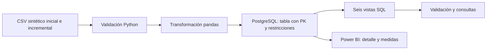

# Arquitectura del pipeline

El proyecto reconstruye con datos sintéticos una operación de Backoffice. Cada fila representa el estado actual de un trámite. Los datos no reflejan indicadores reales de Telecom.

`sql/schema.sql` define los tipos, la clave primaria y los índices. `src/load_to_postgres.py` ejecuta la carga inicial dentro de una transacción y la incremental con `ON CONFLICT DO NOTHING`. La clave primaria garantiza la unicidad incluso cuando hay intentos de carga concurrentes. Los dos lotes de muestra permiten reproducir 7.500 casos.

Power BI usa la tabla detallada y una dimensión calendario para que los filtros actúen sobre las medidas. Las seis vistas SQL sirven para consultas y validación, pero no se relacionan entre sí en el modelo de Power BI.

## Límites del modelo

- `Aprobado`, `Rechazado` y `Anulado` son estados finales.
- El SLA sintético usa 48 horas corridas. `No aplica` indica que el caso aún no se resolvió.
- La vista diaria agrupa por fecha de recepción y muestra el estado actual de esos casos; no representa cierres ocurridos ese día.
- Sin eventos de transición no se puede reconstruir un backlog histórico exacto.
- El volumen de 7.500 casos permite inserciones por lotes; un sistema mayor necesitaría una tabla de staging y cargas masivas.
