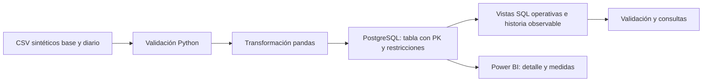
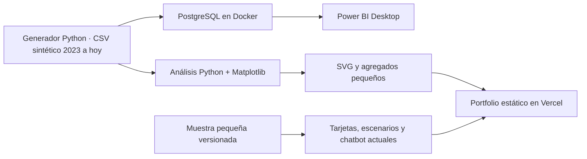

# Arquitectura del pipeline

El proyecto reconstruye con datos sintéticos una operación de Backoffice. Cada fila representa el estado actual de un trámite. Los datos no reflejan indicadores reales de Telecom.

`sql/schema.sql` define los tipos, la clave primaria y los índices. `src/load_to_postgres.py` ejecuta la carga inicial dentro de una transacción, el lote base incremental con `ON CONFLICT DO NOTHING` y la extensión diaria con actualización solo de filas modificadas. La clave primaria garantiza la unicidad. Los dos lotes base reproducen 7.500 casos; la [extensión diaria](daily_synthetic_updates.md) aumenta esa cantidad.

Power BI usa la tabla detallada y una dimensión calendario para que los filtros actúen sobre las medidas. Las vistas SQL sirven para consultas y validación, pero no se relacionan entre sí en el modelo de Power BI.

## Dos recorridos de presentación

La tabla `public.portability_cases_full` conserva el detalle de escala completa para el PBIX; el origen se cambia en Power Query cuando el autor termine el informe. El análisis Matplotlib lee **el mismo CSV completo**, verifica el SHA-256 y publica un SVG y un JSON agregado. La web no requiere acceso público a PostgreSQL, credenciales ni Docker.

Por ahora, las tarjetas, escenarios y respuestas del chatbot aún usan la muestra pequeña versionada. La nueva sección Python muestra explícitamente el total y la fecha de corte del dataset grande; no se deben comparar sus cifras como si provinieran del mismo alcance. Para migrar esas otras piezas a la escala completa, conviene construir una tabla agregada por fecha, estado, equipo y canal durante el build y adaptar el motor de consultas a conteos ponderados y backlog diario. El detalle de casi un millón de filas no debe viajar a la función de Vercel.

Un horizonte como enero de 2028 sería **una proyección sintética**, porque hoy todavía no ocurrieron esos trámites. Se puede generar con el mismo perfil y otra semilla/versión, pero debe conservar `fecha_real_de_corte`, `horizonte_proyectado` y `tipo=proyección` en los metadatos. La web tendría un selector «Hasta hoy / Escenario 2028» que cambie conjuntamente tarjetas, gráficos, escenarios y chat. Power BI permanecería conectado a la tabla local de datos hasta hoy; cualquier proyección iría en una tabla o modo aparte. Véase [ruta propuesta](web_projection_plan.md).

## Límites del modelo

- `Aprobado`, `Rechazado` y `Anulado` son estados finales.
- El SLA sintético usa 48 horas corridas. `No aplica` indica que el caso aún no se resolvió.
- La vista diaria agrupa por fecha de recepción y muestra el estado actual de esos casos; no representa cierres ocurridos ese día.
- Las fechas de recepción y cierre permiten reconstruir el backlog al final de cada día, suponiendo que no hay reaperturas. No permiten conocer los estados intermedios. Ver [historia observable](observable_history.md).
- La muestra actual se carga en lotes de 500 filas; si crece mucho más, convendrá usar staging y carga masiva.
