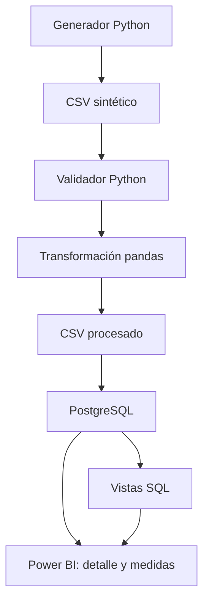

# Arquitectura del pipeline de portabilidad

## Propósito

Reproducir un proceso analítico de Backoffice con datos sintéticos: generar casos, comprobar su calidad, transformarlos, cargarlos a PostgreSQL y consumir indicadores en Power BI.

## Responsabilidades

| Componente | Archivo | Entrada → salida |
|---|---|---|
| Generación | `src/generate_data.py` | Semilla 42 → `data/sample/portability_cases.csv` |
| Validación | `src/validation/validate_data.py` | CSV de ejemplo → errores o confirmación |
| Transformación | `src/transformations/transform_cases.py` | CSV de ejemplo → `data/processed/portability_cases_clean.csv` |
| Persistencia | `docker-compose.yml`, `src/load_to_postgres.py` | CSV procesado → `public.portability_cases` |
| Consultas | `sql/analytics/01_operational_views.sql` | Tabla → cinco vistas agregadas |
| Presentación | `dashboard/portability_operations.pbix` | Tabla/vistas → tablero |

## Modelo actual

La tabla `portability_cases` representa una fila por trámite, con el **estado actual** del caso. El script de carga utiliza `pandas.to_sql(..., if_exists="replace")`: vuelve a crear la tabla y no implementa carga incremental ni esquema de tipos/índices explícito. PostgreSQL corre en Docker; el volumen conserva los datos tras un reinicio, pero no se incluye al copiar el repositorio.

Las vistas `vw_portability_kpis`, `vw_cases_by_status`, `vw_daily_volume`, `vw_team_performance` y `vw_sla_by_channel` contienen agregados a diferentes granularidades. No hay una relación automática entre estas vistas: un filtro de canal tomado de `portability_cases` no necesariamente filtrará una tarjeta basada en `vw_portability_kpis`. Para la primera página interactiva, usar medidas de Power BI sobre `portability_cases`.

## Decisiones de negocio y límites

- `Aprobado`, `Rechazado` y `Anulado` son estados finales; los demás se consideran abiertos.
- El SLA de 48 horas se aplica a casos finalizados; `No aplica` significa que el caso todavía no tiene tiempo de resolución, **no** que está cumpliendo SLA.
- `resolution_hours` usa horas corridas, no horario hábil.
- `vw_daily_volume` agrupa por fecha de recepción; sus columnas de cerrados y pendientes describen el estado actual de casos recibidos ese día. Para cierres diarios reales hay que agrupar por `closed_at`.
- El dataset es una instantánea sintética; no registra cambios de estado, por lo que no permite calcular backlog histórico exacto por día.
- Los valores de equipos, causas y canales son ficticios. El PBIX corporativo original no debe publicarse como parte de este portfolio.

## Evolución prevista

Agregar pruebas y tipos de datos explícitos; separar staging y modelo analítico; implementar carga idempotente o incremental; construir dimensión calendario y un histórico de eventos para medir backlog y SLA a una fecha de corte. Posteriormente evaluar dbt y un orquestador.
