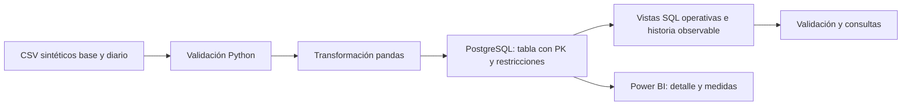

# Arquitectura del pipeline

El proyecto reconstruye con datos sintéticos una operación de Backoffice. Cada fila representa el estado actual de un trámite. Los datos no reflejan indicadores reales de Telecom.

`sql/schema.sql` define los tipos, la clave primaria y los índices. `src/load_to_postgres.py` ejecuta la carga inicial dentro de una transacción, el lote base incremental con `ON CONFLICT DO NOTHING` y la extensión diaria con actualización solo de filas modificadas. La clave primaria garantiza la unicidad. Los dos lotes base reproducen 7.500 casos; la [extensión diaria](daily_synthetic_updates.md) aumenta esa cantidad.

Power BI usa la tabla detallada y una dimensión calendario para que los filtros actúen sobre las medidas. Las vistas SQL sirven para consultas y validación, pero no se relacionan entre sí en el modelo de Power BI.

## Límites del modelo

- `Aprobado`, `Rechazado` y `Anulado` son estados finales.
- El SLA sintético usa 48 horas corridas. `No aplica` indica que el caso aún no se resolvió.
- La vista diaria agrupa por fecha de recepción y muestra el estado actual de esos casos; no representa cierres ocurridos ese día.
- Las fechas de recepción y cierre permiten reconstruir el backlog al final de cada día, suponiendo que no hay reaperturas. No permiten conocer los estados intermedios. Ver [historia observable](observable_history.md).
- La muestra actual se carga en lotes de 500 filas; si crece mucho más, convendrá usar staging y carga masiva.
