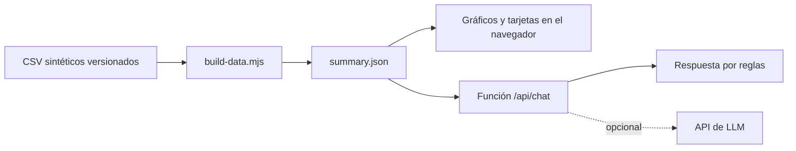

# Portfolio web de Portability Data Pipeline

Esta web muestra cómo se construye y evoluciona el pipeline de portabilidad. La URL publicada comunicada por el autor es [portability-data-pipeline.vercel.app](https://portability-data-pipeline.vercel.app/). El sitio muestra datos sintéticos de ejemplo; no contiene información de clientes ni consulta sistemas de Telecom.

## Qué puede ver una persona que visita el sitio

1. Una introducción al problema operativo y al objetivo del proyecto.
2. Cinco etapas del flujo: generación, validación, transformación, carga y exploración.
3. Indicadores de la muestra versionada: total, abiertos, cerrados, SLA, volumen mensual y estados.
4. Un asistente para preguntas sobre las métricas disponibles.
5. El estado actual del proyecto y las próximas mejoras, con enlace al repositorio.

El sitio está hecho con HTML, CSS y JavaScript sin un framework de interfaz. La aplicación de datos principal sigue en Python y PostgreSQL; Vercel aloja una presentación derivada de los CSV, no ejecuta el pipeline completo.

## Cómo llegan los datos a la página



[`scripts/build-data.mjs`](scripts/build-data.mjs) lee los dos CSV de `../data/sample` y calcula totales por estado, canal, equipo y mes. También calcula abiertos, cerrados y el SLA sintético de 48 horas entre los casos cerrados. Escribe `public/data/summary.json` durante el build. Ese archivo es un artefacto generado y está excluido de Git.

[`public/app.js`](public/app.js) carga ese JSON y dibuja las tarjetas y gráficos. La web muestra una **instantánea de cada despliegue**: si cambian los CSV, hay que construir y desplegar nuevamente. Los hitos de la sección «Proyecto vivo» son texto editorial en `public/index.html`; se actualizan manualmente cuando el proyecto avanza. No hay sincronización en tiempo real con PostgreSQL ni con el PBIX.

## El asistente actual

El navegador envía `POST /api/chat` con una pregunta de hasta 300 caracteres y un modo:

```json
{"question":"¿Cuál es el cumplimiento de SLA?","mode":"dataset"}
```

La función [`api/chat.mjs`](api/chat.mjs) lee solo el resumen generado. [`lib/answer.mjs`](lib/answer.mjs) reconoce palabras clave y responde sobre total, abiertos/cerrados, estados, SLA, canal, equipo, período y evolución mensual. En modo `dataset` no llama a ningún modelo y no tiene costo de tokens. Por ejemplo, informa el numerador, denominador y definición del SLA. Ante una pregunta fuera de ese alcance, explica qué métricas sí puede responder.

Este es un asistente de preguntas frecuentes sobre **agregados predefinidos**, no una interfaz de consulta libre a cada fila. No permite filtrar dos dimensiones a la vez, comparar motivos por equipo, calcular medianas ni reconstruir un backlog pasado. Tampoco ejecuta SQL enviado por visitantes.

### Modo LLM opcional

Si la persona marca la casilla de LLM **y** existe `OPENAI_API_KEY` en las variables de servidor de Vercel, la función envía al modelo la pregunta, el resumen agregado y la respuesta calculada por reglas. El modelo por defecto es `gpt-4.1-mini` y se puede cambiar con `OPENAI_MODEL`. La clave nunca va al navegador ni a Git. Si la llamada falla, la función devuelve la respuesta por reglas.

El texto de un LLM **no tiene validación automática de cifras** después de generarse: el prompt limita el contexto, pero una respuesta nueva puede cometer errores. Por eso el modo determinista es el predeterminado. Una versión más sólida usaría un catálogo de métricas, filtros estructurados y una comprobación de cifras antes de mostrar el texto del modelo.

### Ejemplos de preguntas

| Pregunta | Respuesta actual |
|---|---|
| «¿Cuántos casos siguen abiertos?» | Total abierto de la instantánea y advertencia sobre backlog histórico. |
| «¿Cuál es el SLA?» | Dentro/fuera de 48 horas y porcentaje entre casos cerrados. |
| «¿Qué canal tiene más casos?» | Canal principal y desglose por canal. |
| «¿Cómo evolucionó el volumen mensual?» | Casos recibidos por mes, no cierres mensuales. |
| «¿Qué equipo tuvo más rechazos en mayo?» | No puede responder esa combinación con el resumen actual. |

## Estructura de archivos

| Ruta | Función |
|---|---|
| `public/index.html` | Contenido, secciones e hitos del portfolio. |
| `public/styles.css` | Diseño adaptable a pantallas grandes y móviles. |
| `public/app.js` | Tarjetas, gráficos y formulario del chat. |
| `scripts/build-data.mjs` | Resumen derivado de los CSV. |
| `lib/answer.mjs` | Respuestas deterministas. |
| `api/chat.mjs` | Función de Vercel y modo LLM opcional. |
| `tests/answer.test.mjs` | Pruebas de reglas del asistente. |

También hay una entrada [`../api/chat.mjs`](../api/chat.mjs) y [`../vercel.json`](../vercel.json) para desplegar desde la raíz del repositorio. `web/vercel.json` permite desplegar con `web` como directorio raíz. La configuración de la raíz es la usada para resolver el error de detección automática de Python.

## Desplegar y actualizar en Vercel

1. Importar `SouthClvbDev/portability-data-pipeline` desde GitHub.
2. Dejar **Root Directory** en la raíz del repositorio y seleccionar **Framework Preset: Other**. `vercel.json` ejecuta `npm run build` y publica `web/public`. La función `/api/chat` está en `api/chat.mjs`.
3. Si el proyecto conserva el preset Python de una importación anterior, cambiarlo en **Project Settings → Build and Deployment** y volver a desplegar.
4. Cada push a `main` puede crear un nuevo despliegue si la integración Git está habilitada. Confirmar en Vercel que el build termina y probar la página y el chat.
5. Para activar el modo LLM, agregar `OPENAI_API_KEY` como variable de entorno **del servidor** en Vercel y volver a desplegar. `OPENAI_MODEL` es opcional. La clave no debe llevar el prefijo `NEXT_PUBLIC_` ni guardarse en el repositorio.

Se puede usar `web` como Root Directory, Framework Preset **Other** y su `vercel.json` local. Hay que mantener alineados directorio raíz, comando de build y directorio de salida; no mezclar valores de ambas configuraciones.

Vercel no necesita la base PostgreSQL ni Docker para servir esta web. El pipeline en sí se reconstruye con `bash scripts/demo.sh` en un entorno con Docker. El resumen web se genera desde los CSV versionados, por lo que puede diferir de una base PostgreSQL modificada localmente.

## Desarrollo y verificación local

Desde la raíz del repositorio:

```bash
npm run build
npm run test:web
```

También se puede trabajar desde `web` con `npm ci`, `npm run build` y `npm test`. Para probar la función HTTP de Vercel localmente se necesita la CLI (`npx vercel dev`) y una sesión de Vercel. Servir `web/public` con un servidor estático permite revisar la interfaz y el JSON, pero no proporciona `/api/chat`.

El CI ejecuta los tests y el build de la web, además del pipeline Python/PostgreSQL. Para un despliegue real, comprobar en la URL publicada: tarjetas, gráficos, respuesta del chat, diseño móvil y errores en los logs de funciones.

## Opciones de costo para el LLM

La opción **gratis y estable para comenzar** es el modo `dataset` actual: ya responde cifras concretas sin llamar a un proveedor. Para lenguaje natural más flexible, algunos proveedores ofrecen cuotas gratuitas de desarrollo, por ejemplo Gemini API, Groq o Cloudflare Workers AI, pero sus límites, condiciones y disponibilidad cambian. Antes de elegir uno hay que comprobar la tarifa vigente y si admite uso público desde una función de Vercel. La cuenta gratuita de ChatGPT no equivale a crédito gratuito para la API de OpenAI.

La integración actual solo implementa OpenAI Responses API; usar otro proveedor requiere adaptar `api/chat.mjs`. Una API gratuita puede imponer límites por minuto, solicitudes diarias, disponibilidad o políticas de datos. En una web pública, una clave sin control de abuso puede agotar la cuota o generar cargos. Antes de activarla conviene añadir límites por visitante, observabilidad y un presupuesto máximo del proveedor.

## Privacidad y límites analíticos

- Los CSV y el resumen son sintéticos y públicos. El chat no recibe datos reales de clientes.
- El modo LLM envía la pregunta del visitante y el resumen agregado al proveedor configurado. No pedir información personal en el chat.
- El dataset registra el estado actual de cada caso; no permite reconstruir transiciones ni backlog histórico.
- Las respuestas describen esta muestra, no resultados de una operación real.
