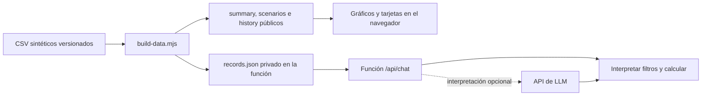

# Portfolio web de Portability Data Pipeline

Esta web muestra cómo se construye y evoluciona el pipeline de portabilidad. La URL publicada comunicada por el autor es [portability-data-pipeline.vercel.app](https://portability-data-pipeline.vercel.app/). El sitio muestra datos sintéticos de ejemplo; no contiene información de clientes ni consulta sistemas de Telecom.

## Qué puede ver una persona que visita el sitio

1. Un caso de decisión ejecutivo: comparar el mes de mayor volumen con el de peor SLA del dataset sintético grande y explicar qué investigar antes de atribuir una causa.
2. Indicadores operativos de la muestra pequeña versionada: total, abiertos, cerrados, SLA, volumen mensual y estados. Un gráfico permite seleccionar una fecha y ver el backlog al cierre del día, con ventanas de 90 días, 12 meses o toda la historia.
3. Gráficos Matplotlib sobre el CSV grande y sus hallazgos calculados.
4. Cinco etapas del flujo: generación, validación, transformación, carga y exploración.
5. Cuatro escenarios guiados con preguntas orientadas a investigación. Permiten llevar la misma pregunta al asistente.
6. Una galería de las tres páginas del Power BI, con capturas reales cuando estén disponibles y un estado pendiente explícito cuando falten; el PBIX sigue bajo edición.
7. Un asistente para preguntas sobre las métricas disponibles, incluido backlog a una fecha.
8. Un recorrido progresivo por nueve etapas del proyecto, cada una con enlace a su evidencia en el repositorio.

La [revisión de storytelling](../docs/storytelling_review.md) explica el orden de lectura, la interpretación del caso y las limitaciones que siguen abiertas.

El sitio está hecho con HTML, CSS y JavaScript sin un framework de interfaz. La aplicación de datos principal sigue en Python y PostgreSQL; Vercel aloja una presentación derivada de los CSV, no ejecuta el pipeline completo.

El [dataset de escala completa para Power BI](../docs/full_scale_dataset.md) se genera y distribuye aparte. La sección «Análisis con Python» sí usa ese CSV para sus gráficos Matplotlib, muestra meses de mayor y menor SLA calculados y publica la fecha de corte. La [historia operacional sintética](../docs/synthetic_story.md) explica las demoras y mejoras simuladas. Sus volúmenes no son los de las tarjetas o respuestas del chatbot, que siguen usando la muestra pequeña versionada. La [propuesta de migración completa y escenario 2028](../docs/web_projection_plan.md) explica el siguiente paso.

## Cómo llegan los datos a la página



[`scripts/build-data.mjs`](scripts/build-data.mjs) lee los tres CSV versionados de `../data/sample` y verifica que el lote diario coincida con su [fecha de corte](../data/sample/portability_cases_daily.meta.json). Calcula totales por estado, canal, equipo y mes; también abiertos, cerrados y el SLA sintético de 48 horas entre los casos cerrados. Escribe `public/data/summary.json`, `public/data/scenarios.json` y `public/data/history.json` para la página; `data/records.json` conserva los campos necesarios para consultas del chat. Los cuatro se generan durante el build y se excluyen de Git; el último se empaqueta en la función, no se publica como archivo estático.

[`public/app.js`](public/app.js) carga esos JSON y dibuja las tarjetas, gráficos, escenarios y serie diaria. El gráfico mensual muestra los últimos 12 meses; el escenario guiado conserva la serie completa. Los escenarios se definen en [`lib/scenarios.mjs`](lib/scenarios.mjs) y se calculan con el mismo motor de consultas del chat; sus cifras no están escritas a mano en la interfaz. El recorrido de «Proyecto vivo» se edita en [`public/data/timeline.json`](public/data/timeline.json): cada etapa describe un resultado y enlaza código comprobable. La web muestra una **instantánea de cada despliegue**: si cambian los CSV, hay que construir y desplegar nuevamente. La fecha de actualización se toma del manifiesto del lote diario, no de la hora de build. El [plan de siguientes escenarios](../docs/next_scenarios.md) fija los criterios de evolución. No hay sincronización en tiempo real con PostgreSQL ni con el PBIX.

### Backlog a fecha de corte

[`lib/history.mjs`](lib/history.mjs) usa únicamente `received_at` y `closed_at`. Al final de un día, cuenta casos recibidos hasta esa fecha que aún no habían cerrado. La serie diaria, la vista SQL y el asistente comparten esa definición. Los cierres posteriores a la última recepción explican por qué el backlog al 30 de junio puede diferir de la instantánea final. No se conocen cambios entre estados abiertos ni reaperturas; ver [definición y límites](../docs/observable_history.md).

### Galería del informe Power BI

[`scripts/build-report.mjs`](scripts/build-report.mjs) crea `public/data/report.json` con las tres páginas de contenido del PBIX. Las imágenes son **opcionales**: solo copia capturas PNG presentes en [`evidence/`](evidence/README.md), donde se explica cómo exportarlas y nombrarlas. La construcción verifica la firma PNG y una resolución mínima de 1200 × 675. Sin capturas, la web indica «Captura pendiente» en cada página. No se generan imágenes simuladas ni se extraen visuales del PBIX automáticamente. Las imágenes fuente se versionan si se desea publicarlas; las copias generadas en `public/report/` se excluyen de Git.

## El asistente actual

El navegador envía `POST /api/chat` con una pregunta de hasta 300 caracteres y un modo:

```json
{"question":"¿Cuál es el cumplimiento de SLA?","mode":"dataset"}
```

La función [`api/chat.mjs`](api/chat.mjs) lee los registros proyectados. [`lib/query.mjs`](lib/query.mjs) traduce preguntas frecuentes a una métrica, una agrupación y filtros por estado, mes, canal o equipo. El servidor filtra y calcula el resultado; en modo `dataset` no llama a ningún modelo y no tiene costo de tokens. Para SLA usa solo casos resueltos como denominador. También calcula promedios de horas de resolución.

Puede combinar filtros, por ejemplo rechazos por equipo en mayo de 2023, sin ejecutar SQL enviado por visitantes. Como ahora hay varios años, un mes nombrado sin año puede ser ambiguo; el asistente pide precisarlo. Para backlog acepta una fecha ISO completa dentro del período observado, por ejemplo «backlog al 2023-05-31», y filtros por equipo o canal. No interpreta todavía todas las formulaciones posibles. Las preguntas sobre causas, medianas, estados intermedios o reaperturas se rechazan porque faltan datos o una definición analítica adecuada.

### Modo LLM opcional

Si la persona marca la casilla de IA **y** existe `GEMINI_API_KEY` o `OPENAI_API_KEY` en las variables de servidor de Vercel, la función envía al proveedor la pregunta y un catálogo de valores permitidos. Gemini tiene prioridad si ambas claves están presentes. Los modelos por defecto son `gemini-2.5-flash-lite` y `gpt-4.1-mini`; se pueden cambiar con `GEMINI_MODEL` y `OPENAI_MODEL`. Ninguna clave se envía al navegador ni se guarda en Git.

El modelo devuelve únicamente una especificación de métrica, agrupación y filtros. El servidor valida sus valores contra el dataset y calcula la respuesta numérica. Si la interpretación falla, usa las reglas locales. Esto evita que la redacción de la IA invente cifras, aunque todavía puede interpretar mal la intención. El modo sin IA sigue siendo el predeterminado.

Al cargar la página, `GET /api/chat` informa solamente si existe un proveedor configurado y su nombre; no llama al modelo, no consume cuota y no expone la API key. La interfaz muestra **Gemini configurado** cuando encuentra la variable. Después de cada pregunta cambia a **Gemini activo** si el modelo interpretó esa consulta, **IA configurada · respuesta con reglas** si se aplicó el fallback determinista, o **IA sin configurar** si la función no encuentra una clave.

Sin almacenamiento compartido, existe un límite básico de **10 intentos de IA por IP y hora por instancia de función**. En serverless varias instancias o reinicios no comparten ese contador. Si se configuran `UPSTASH_REDIS_REST_URL` y `UPSTASH_REDIS_REST_TOKEN`, una operación atómica en Redis aplica además **30 interpretaciones por hora para todo el sitio** y **10 por visitante y hora**, incluso entre instancias. La clave del visitante se deriva de un hash de la IP; no se guarda la IP en claro en Redis. Si Redis falla o solo está configurada una de las dos variables, el modo IA usa la respuesta determinista y no llama al modelo. El modo `dataset` nunca depende de Redis.

La cuota de aplicación limita llamadas, pero no sustituye un presupuesto o límite de gasto del proveedor. Las cuotas gratuitas y condiciones de Upstash o del proveedor del modelo pueden cambiar; verificar el plan antes de habilitarlos.

### Ejemplos de preguntas

| Pregunta | Respuesta actual |
|---|---|
| «¿Cuántos casos siguen abiertos?» | Total abierto de la instantánea. |
| «¿Cuál era el backlog al 2023-05-31?» | Abiertos al cierre de esa fecha según recepciones y cierres. |
| «¿Cuál es el SLA?» | Dentro/fuera de 48 horas y porcentaje entre casos cerrados. |
| «¿Qué canal tiene más casos?» | Canal principal y desglose por canal. |
| «¿Cómo evolucionó el volumen mensual?» | Casos recibidos por mes, no cierres mensuales. |
| «¿Qué equipo tuvo más rechazos en mayo de 2023?» | Filtra mayo de 2023 y rechazos, agrupa por equipo y muestra los conteos. |
| «¿Cuál es el SLA por canal?» | Calcula dentro de SLA / resueltos para cada canal. |
| «¿Cuál es la resolución promedio de Backoffice Norte?» | Promedia horas entre casos resueltos del equipo. |

## Estructura de archivos

| Ruta | Función |
|---|---|
| `public/index.html` | Contenido, secciones e hitos del portfolio. |
| `public/styles.css` | Diseño adaptable a pantallas grandes y móviles. |
| `public/app.js` | Tarjetas, gráficos y formulario del chat. |
| `scripts/build-data.mjs` | Resumen público y registros proyectados privados derivados de los CSV. |
| `scripts/build-report.mjs` | Manifiesto de páginas y copia de capturas reales del PBIX. |
| `evidence/` | Capturas exportadas del informe y guía para incorporarlas. |
| `lib/query.mjs` | Interpretación local, filtros, cálculos y respuesta. |
| `lib/scenarios.mjs` | Definiciones de los cuatro escenarios guiados. |
| `lib/history.mjs` | Serie diaria y cálculo de backlog a fecha de corte. |
| `public/data/timeline.json` | Recorrido progresivo editable con enlaces a evidencia. |
| `api/chat.mjs` | Función de Vercel; interpretación opcional con Gemini u OpenAI. |
| `tests/*.test.mjs` | Pruebas de cruces, API y consistencia entre escenarios y dataset. |

También hay una entrada [`../api/chat.mjs`](../api/chat.mjs) y [`../vercel.json`](../vercel.json) para desplegar desde la raíz del repositorio. `web/vercel.json` permite desplegar con `web` como directorio raíz. La configuración de la raíz es la usada para resolver el error de detección automática de Python.

## Desplegar y actualizar en Vercel

1. Importar `SouthClvbDev/portability-data-pipeline` desde GitHub.
2. Dejar **Root Directory** en la raíz del repositorio y seleccionar **Framework Preset: Other**. `vercel.json` ejecuta `npm run build` y publica `web/public`. La función `/api/chat` está en `api/chat.mjs`.
3. Si el proyecto conserva el preset Python de una importación anterior, cambiarlo en **Project Settings → Build and Deployment** y volver a desplegar.
4. Cada push a `main` puede crear un nuevo despliegue si la integración Git está habilitada. Confirmar en Vercel que el build termina y probar la página y el chat.
   La [tarea diaria](../docs/daily_synthetic_updates.md) genera y commitea nuevas filas; si el push del bot no dispara Vercel, configurar el secreto `VERCEL_DEPLOY_HOOK_URL` en GitHub para solicitar el despliegue.
5. Para activar la interpretación con IA, agregar **una** de `GEMINI_API_KEY` u `OPENAI_API_KEY` como variable de entorno del servidor en Vercel y volver a desplegar. `GEMINI_MODEL` y `OPENAI_MODEL` son opcionales. La clave no debe llevar el prefijo `NEXT_PUBLIC_` ni guardarse en el repositorio.
6. Para un límite compartido entre instancias, crear una base Redis REST compatible con Upstash y agregar `UPSTASH_REDIS_REST_URL` y `UPSTASH_REDIS_REST_TOKEN` en Vercel. Probar que, al agotarse la cuota, el chat continúa respondiendo en modo `dataset`. Configurar además un límite de gasto en el proveedor del modelo.

Se puede usar `web` como Root Directory, Framework Preset **Other** y su `vercel.json` local. Hay que mantener alineados directorio raíz, comando de build y directorio de salida; no mezclar valores de ambas configuraciones.

Vercel no necesita la base PostgreSQL ni Docker para servir esta web. El pipeline en sí se reconstruye con `bash scripts/demo.sh` en un entorno con Docker. El resumen web se genera desde los CSV versionados, por lo que puede diferir de una base PostgreSQL modificada localmente.

## Desarrollo y verificación local

Desde la raíz del repositorio:

```bash
npm run build
npm run test:web
```

También se puede trabajar desde `web` con `npm ci`, `npm run build` y `npm test`. Para probar la función HTTP de Vercel localmente se necesita la CLI (`npx vercel dev`) y una sesión de Vercel. Servir `web/public` con un servidor estático permite revisar la interfaz y el JSON, pero no proporciona `/api/chat`.

El CI ejecuta los tests y el build de la web, además del pipeline Python/PostgreSQL. Para un despliegue real, comprobar en la URL publicada: tarjetas, gráficos, respuesta del chat, diseño móvil y errores en los logs de funciones.

## Opciones de costo para el LLM

La opción **gratis y estable para comenzar** es el modo `dataset` actual: ya responde cifras concretas sin llamar a un proveedor. Para lenguaje natural más flexible, algunos proveedores ofrecen cuotas gratuitas de desarrollo, por ejemplo Gemini API, Groq o Cloudflare Workers AI, pero sus límites, condiciones y disponibilidad cambian. Antes de elegir uno hay que comprobar la tarifa vigente y si admite uso público desde una función de Vercel. La cuenta gratuita de ChatGPT no equivale a crédito gratuito para la API de OpenAI.

La integración implementa Gemini API y OpenAI Responses API. Una API gratuita puede imponer límites por minuto, solicitudes diarias, disponibilidad o políticas de datos; comprobar las condiciones vigentes al crear la clave. En una web pública, el límite local por instancia no garantiza un techo global de consumo. La integración Redis opcional agrega ese techo compartido; establecer también un presupuesto o cuota dura en el proveedor antes de activarla.

## Privacidad y límites analíticos

- Los CSV y el resumen son sintéticos y públicos. El chat no recibe datos reales de clientes.
- El modo IA envía la pregunta del visitante y un catálogo de valores permitidos al proveedor configurado. No pedir información personal en el chat.
- El backlog al cierre de cada día se puede calcular con recepciones y cierres, bajo el supuesto de que no hay reaperturas. No se pueden reconstruir estados intermedios.
- Las respuestas describen esta muestra, no resultados de una operación real.
