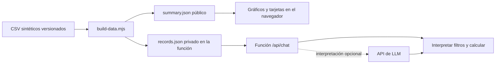

# Portfolio web de Portability Data Pipeline

Esta web muestra cómo se construye y evoluciona el pipeline de portabilidad. La URL publicada comunicada por el autor es [portability-data-pipeline.vercel.app](https://portability-data-pipeline.vercel.app/). El sitio muestra datos sintéticos de ejemplo; no contiene información de clientes ni consulta sistemas de Telecom.

## Qué puede ver una persona que visita el sitio

1. Una introducción al problema operativo y al objetivo del proyecto.
2. Cinco etapas del flujo: generación, validación, transformación, carga y exploración.
3. Indicadores de la muestra versionada: total, abiertos, cerrados, SLA, volumen mensual y estados.
4. Cuatro escenarios guiados: volumen por mes, pendientes por equipo, SLA por canal y rechazos por equipo en mayo. Permiten llevar la misma pregunta al asistente.
5. Un asistente para preguntas sobre las métricas disponibles.
6. El estado actual del proyecto y las próximas mejoras, con enlace al repositorio.

El sitio está hecho con HTML, CSS y JavaScript sin un framework de interfaz. La aplicación de datos principal sigue en Python y PostgreSQL; Vercel aloja una presentación derivada de los CSV, no ejecuta el pipeline completo.

## Cómo llegan los datos a la página



[`scripts/build-data.mjs`](scripts/build-data.mjs) lee los dos CSV de `../data/sample` y calcula totales por estado, canal, equipo y mes. También calcula abiertos, cerrados y el SLA sintético de 48 horas entre los casos cerrados. Escribe `public/data/summary.json` para la página, `public/data/scenarios.json` para la demo y `data/records.json` con los campos necesarios para consultas combinadas. Los tres se generan durante el build y se excluyen de Git; el último se empaqueta en la función, no se publica como archivo estático.

[`public/app.js`](public/app.js) carga esos JSON y dibuja las tarjetas, gráficos y escenarios. Los escenarios se definen en [`lib/scenarios.mjs`](lib/scenarios.mjs) y se calculan con el mismo motor de consultas del chat; sus cifras no están escritas a mano en la interfaz. La web muestra una **instantánea de cada despliegue**: si cambian los CSV, hay que construir y desplegar nuevamente. Los hitos de la sección «Proyecto vivo» son texto editorial en `public/index.html`; se actualizan manualmente cuando el proyecto avanza. El [plan de siguientes escenarios](../docs/next_scenarios.md) fija los criterios de evolución. No hay sincronización en tiempo real con PostgreSQL ni con el PBIX.

## El asistente actual

El navegador envía `POST /api/chat` con una pregunta de hasta 300 caracteres y un modo:

```json
{"question":"¿Cuál es el cumplimiento de SLA?","mode":"dataset"}
```

La función [`api/chat.mjs`](api/chat.mjs) lee los registros proyectados. [`lib/query.mjs`](lib/query.mjs) traduce preguntas frecuentes a una métrica, una agrupación y filtros por estado, mes, canal o equipo. El servidor filtra y calcula el resultado; en modo `dataset` no llama a ningún modelo y no tiene costo de tokens. Para SLA usa solo casos resueltos como denominador. También calcula promedios de horas de resolución.

Puede combinar filtros, por ejemplo rechazos por equipo en mayo, sin ejecutar SQL enviado por visitantes. No interpreta todavía todas las formulaciones posibles. Las preguntas sobre causas o motivos, medianas y backlog histórico se rechazan porque faltan datos o una definición analítica adecuada.

### Modo LLM opcional

Si la persona marca la casilla de IA **y** existe `GEMINI_API_KEY` o `OPENAI_API_KEY` en las variables de servidor de Vercel, la función envía al proveedor la pregunta y un catálogo de valores permitidos. Gemini tiene prioridad si ambas claves están presentes. Los modelos por defecto son `gemini-2.5-flash-lite` y `gpt-4.1-mini`; se pueden cambiar con `GEMINI_MODEL` y `OPENAI_MODEL`. Ninguna clave se envía al navegador ni se guarda en Git.

El modelo devuelve únicamente una especificación de métrica, agrupación y filtros. El servidor valida sus valores contra el dataset y calcula la respuesta numérica. Si la interpretación falla, usa las reglas locales. Esto evita que la redacción de la IA invente cifras, aunque todavía puede interpretar mal la intención. El modo sin IA sigue siendo el predeterminado.

Existe un límite de **10 intentos de IA por IP y hora por instancia de función**. Es una protección básica: en serverless varias instancias o reinicios no comparten ese contador. Para una cuota global y control de costos en un sitio público se necesita un almacenamiento compartido o el control de cuota del proveedor. También se recomienda un presupuesto o límite duro de gasto y revisar logs de la función.

### Ejemplos de preguntas

| Pregunta | Respuesta actual |
|---|---|
| «¿Cuántos casos siguen abiertos?» | Total abierto de la instantánea y advertencia sobre backlog histórico. |
| «¿Cuál es el SLA?» | Dentro/fuera de 48 horas y porcentaje entre casos cerrados. |
| «¿Qué canal tiene más casos?» | Canal principal y desglose por canal. |
| «¿Cómo evolucionó el volumen mensual?» | Casos recibidos por mes, no cierres mensuales. |
| «¿Qué equipo tuvo más rechazos en mayo?» | Filtra mayo y rechazos, agrupa por equipo y muestra los conteos. |
| «¿Cuál es el SLA por canal?» | Calcula dentro de SLA / resueltos para cada canal. |
| «¿Cuál es la resolución promedio de Backoffice Norte?» | Promedia horas entre casos resueltos del equipo. |

## Estructura de archivos

| Ruta | Función |
|---|---|
| `public/index.html` | Contenido, secciones e hitos del portfolio. |
| `public/styles.css` | Diseño adaptable a pantallas grandes y móviles. |
| `public/app.js` | Tarjetas, gráficos y formulario del chat. |
| `scripts/build-data.mjs` | Resumen público y registros proyectados privados derivados de los CSV. |
| `lib/query.mjs` | Interpretación local, filtros, cálculos y respuesta. |
| `lib/scenarios.mjs` | Definiciones de los cuatro escenarios guiados. |
| `api/chat.mjs` | Función de Vercel; interpretación opcional con Gemini u OpenAI. |
| `tests/*.test.mjs` | Pruebas de cruces, API y consistencia entre escenarios y dataset. |

También hay una entrada [`../api/chat.mjs`](../api/chat.mjs) y [`../vercel.json`](../vercel.json) para desplegar desde la raíz del repositorio. `web/vercel.json` permite desplegar con `web` como directorio raíz. La configuración de la raíz es la usada para resolver el error de detección automática de Python.

## Desplegar y actualizar en Vercel

1. Importar `SouthClvbDev/portability-data-pipeline` desde GitHub.
2. Dejar **Root Directory** en la raíz del repositorio y seleccionar **Framework Preset: Other**. `vercel.json` ejecuta `npm run build` y publica `web/public`. La función `/api/chat` está en `api/chat.mjs`.
3. Si el proyecto conserva el preset Python de una importación anterior, cambiarlo en **Project Settings → Build and Deployment** y volver a desplegar.
4. Cada push a `main` puede crear un nuevo despliegue si la integración Git está habilitada. Confirmar en Vercel que el build termina y probar la página y el chat.
5. Para activar la interpretación con IA, agregar **una** de `GEMINI_API_KEY` u `OPENAI_API_KEY` como variable de entorno del servidor en Vercel y volver a desplegar. `GEMINI_MODEL` y `OPENAI_MODEL` son opcionales. La clave no debe llevar el prefijo `NEXT_PUBLIC_` ni guardarse en el repositorio.

Se puede usar `web` como Root Directory, Framework Preset **Other** y su `vercel.json` local. Hay que mantener alineados directorio raíz, comando de build y directorio de salida; no mezclar valores de ambas configuraciones.

Vercel no necesita la base PostgreSQL ni Docker para servir esta web. El pipeline en sí se reconstruye con `bash scripts/demo.sh` en un entorno con Docker. El resumen web se genera desde los CSV versionados, por lo que puede diferir de una base PostgreSQL modificada localmente.

## Desarrollo y verificación local

Desde la raíz del repositorio:

```bash
npm run build
npm run test:web
```

También se puede trabajar desde `web` con `npm ci`, `npm run build` y `npm test`. Para probar la función HTTP de Vercel localmente se necesita la CLI (`npx vercel dev`) y una sesión de Vercel. Servir `web/public` con un servidor estático permite revisar la interfaz y el JSON, pero no proporciona `/api/chat`.

El CI ejecuta los tests y el build de la web, además del pipeline Python/PostgreSQL. Para un despliegue real, comprobar en la URL publicada: tarjetas, gráficos, respuesta del chat, diseño móvil y errores en los logs de funciones.

## Opciones de costo para el LLM

La opción **gratis y estable para comenzar** es el modo `dataset` actual: ya responde cifras concretas sin llamar a un proveedor. Para lenguaje natural más flexible, algunos proveedores ofrecen cuotas gratuitas de desarrollo, por ejemplo Gemini API, Groq o Cloudflare Workers AI, pero sus límites, condiciones y disponibilidad cambian. Antes de elegir uno hay que comprobar la tarifa vigente y si admite uso público desde una función de Vercel. La cuenta gratuita de ChatGPT no equivale a crédito gratuito para la API de OpenAI.

La integración implementa Gemini API y OpenAI Responses API. Una API gratuita puede imponer límites por minuto, solicitudes diarias, disponibilidad o políticas de datos; comprobar las condiciones vigentes al crear la clave. En una web pública, el límite local por instancia no garantiza un techo global de consumo. Establecer un presupuesto o cuota dura en el proveedor antes de activarla.

## Privacidad y límites analíticos

- Los CSV y el resumen son sintéticos y públicos. El chat no recibe datos reales de clientes.
- El modo IA envía la pregunta del visitante y un catálogo de valores permitidos al proveedor configurado. No pedir información personal en el chat.
- El dataset registra el estado actual de cada caso; no permite reconstruir transiciones ni backlog histórico.
- Las respuestas describen esta muestra, no resultados de una operación real.
